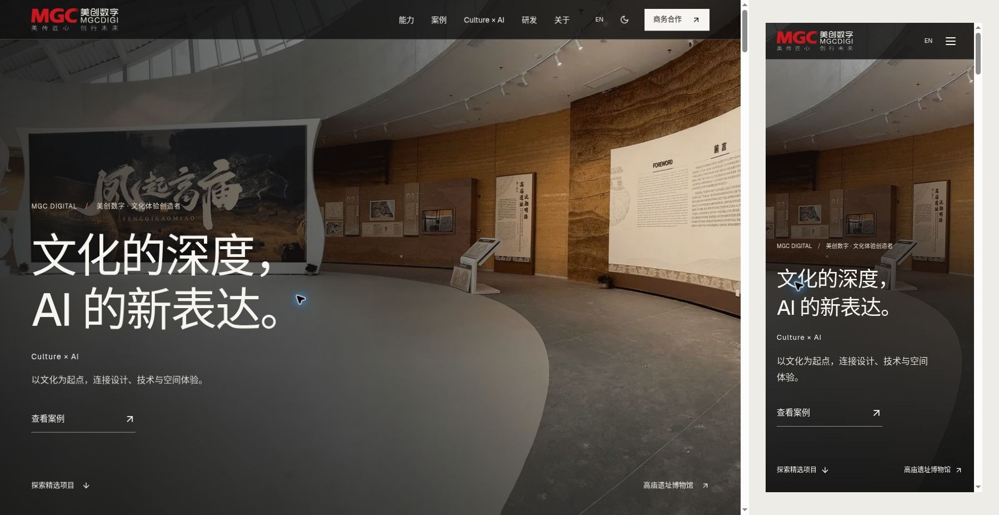
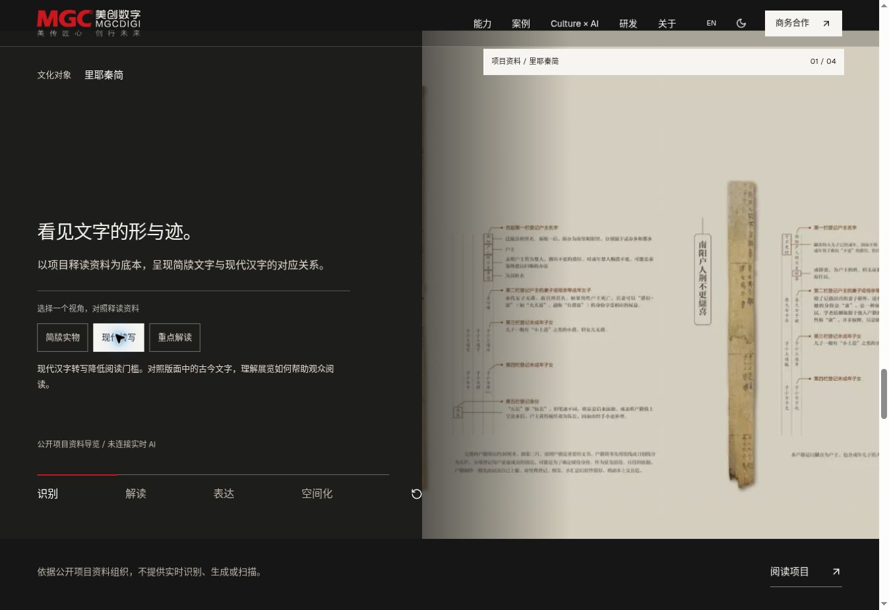
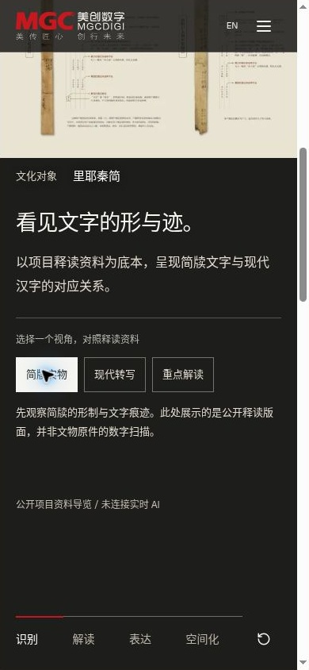

# MGC Digital — Experience Refinement V2.5

2026-11-01 · 从 main `ff08836` 建立 `feature/mgc-experience-v2-5`。仅分支交付，不合并、不发布正式站。命令行 push 缺少凭据，使用已连接 GitHub 插件提交；插件创建的源码 tree SHA 已与本地测试 tree 完全一致。

## 审计与设计决策

详见 [V2.5-AUDIT.md](V2.5-AUDIT.md)。以原有 Next/React/CSS/动效体系改造，保留正式 Logo、品牌色、原始文化项目、双语路径、搜索和所有内容档案。首页把项目证明提前，合并重复的大场景；品牌影片保留在文化主张中，主动打开才加载。

## 实际变更

- `home-page.tsx` / `hero-experience.tsx` / `home.css`：重排首页为 Hero → 旗舰案例 → 文化主张与影片 → 转化过程 → Culture × AI → 研发与公开证据 → 企业 → 商务。首屏下方标题布局、细小品牌题签和明确案例行动。CTA 不再等待入场动画。延续真实横/竖摄影。
- `artifact-journey.tsx`：沿用手机横滑 rail。进度由实际滚动位置决定；桌面以视口锚点选择最近章节，避免 IO entry 顺序造成抢状态。添加桌面章节索引、旋转对齐、资料图版、出处和采集资料边界。键盘 Home/End/方向键继续可用。Reduced Motion 桌面改为每章影像/文字并列。
- `culture-lab.tsx` / `culture-ai.css`：保留四阶段和键盘 tab 模式，新增三重释义阅读视角，联动画面取景与解释文字。改用真实释读版面、展陈与影院照片。既有生成素材文件与出处保留，装置不再使用生成图。手机上下构图，阅读区保留高度，四阶段实测同为 964px，避免切换收缩跳动。
- `case-film.tsx` / `case-reader.tsx`：依据不同案例实际文章内容区分章节；里耶互动显示阅读进度、控件与解释的无障碍关联。保留完整原始资料和下个项目。
- `responsive-image.tsx` / `project-card.tsx`：把全屏 cover 尺寸设为显式选择，普通图片不再全局按手机视口高度扩大资源；双列案例使用 50vw。真实图片保留尺寸、srcset、首屏优先级、lazy loading。
- `motion.css`：保留统一观察器、入场层级和 Reduced Motion。移除默认标题 blur、通用媒体缩放，保留克制的摄影镜头入场、必要的 opacity/transform。反馈时间沿用现有 tokens。
- `shell.css` / `tokens.css`：媒体背景上的导航底色加深，解决浅色资料照片滚经固定白字导航时的对比度问题，不引入背景模糊。
- `contact-form.tsx` / `contact-page.tsx` / `app/en/contact/page.tsx`：共享双语联系页面。本地整理、复制、下载与接口接收明确区分；提交中禁止编辑和重复提交；错误汇总焦点、表单回执焦点、剪贴板失败与请求超时反馈。离开不持久保存个人信息。保留原站电话、地址、地图和原站联系入口。
- `.github/workflows/validate.yml`：PR 检查类型、搜索、Pages 构建与导出，上传静态产物，再验证 standalone 构建与打包。没有 deploy 权限或部署步骤。原 main 发布工作流不变。
- `scripts/prepare-preview.mjs`：独立静态预览及十二页面/十屏宽检查工具，不更改产品页面或 Next dev 启动命令。

## 视觉证据

以下为实际生产导出的 Chrome 截图。首页对照图仅拼接桌面截图与裁出的手机视口；原始截图也在同目录保留。案例摄影的水印及清晰度上限来自现有素材。





## 验证记录

| 项目 | 当前实际结果 |
| --- | --- |
| npm ci | 完成；版本锁未改动依赖，只更新项目版本为 2.5.0 |
| npm run typecheck | 通过 |
| npm run check:search | 通过，中文 198 / 英文 190 索引；museum 回归 55 / 62 |
| Pages build（/meich） | 通过；574 个生成路由（含元数据） |
| npm run check:export | 570 个 HTML，0 失效站内链接/图片 |
| standalone build / package:server | 通过（最新结果以本分支 QA 报告为准） |
| 生产静态页面响应式 | 12 页面 × 10 宽度 = 120 组，无整页横向溢出，均有 h1 |
| 手机流程交互 | 点击第5章、快速反向切到第2章、键盘 End，实际 rail / 索引同步 |
| Culture × AI | 三个阅读视角、四阶段、键盘 End、重置通过；手机四阶段高度相同 |
| 移动菜单/主题 | 展开、退出、深浅主题切换通过 |
| 表单 | 五项错误提示；本地整理明确未发送；复制反馈与实际文本下载已验证 |
| 搜索/筛选 | 博物馆 + venue:museum 返回 46 项；无结果状态可见；索引回归通过 |
| 案例 | 里耶热点 02/03 正确同步解释；完整资料可展开；三旗舰入口及内容可访问 |
| 影片 | 弹层打开/关闭，controls=true、autoplay=false；未声称外部长片已完整播放 |
| 控制台 | 检查的 Chrome 日志只见浏览器扩展 metadata 错误，未见应用异常；不是完整跨浏览器错误审计 |

宽度：320 / 360 / 375 / 390 / 412 / 430 / 768 / 1024 / 1440 / 1920。
页面：中文首页、英文首页、里耶、布达拉宫雪城、高庙、服务、Culture × AI、案例目录、产品目录、中文联系、英文联系、研发。

浏览器结果见 `docs/qa/v2.5-responsive.json`、`v2.5-interactions.json`。截图见 `docs/qa/v2.5/`。基于 Chrome 中的不同宽度 iframe 检查，15px 为桌面滚动条；不能当作真实触屏设备或 Safari 测试。响应式表只检查宽度、h1、语言，不代表 120 张人工视觉审阅。

`npm run check:motion` 已尝试，最初因尚无 `dist/MGC-Enterprise-Server` 启动失败（ENOENT），记录保留在 `docs/qa/motion-regression.json`。后续使用支持的云浏览器完成上述交互验收；没有宣称该独立 Playwright runner 通过。下载事件等待曾超时，但下载文件已在共享目录找到并核对完整内容。

## 性能与未验证项

构建首页 First Load JS：原 114kB，本版约 115kB；共享 103kB 不变。无新增生产依赖。默认大面积 blur 与通用媒体缩放减少。不能据此声称 LCP/CLS/INP 已改善：本环境未重跑 Lighthouse 或采集真实用户指标，旧报告不作为 V2.5 成绩。

未完成物理 iQOO/Android Chrome、iOS Safari、软键盘、真实手指滑动惯性、多 DPR 慢网测试；Reduced Motion 代码降级已实现，但本云浏览器未提供媒体偏好仿真，未声称实际运行测试通过。真实企业收件、服务端失败分支及完整外部影片播放仍需接入环境验收。

## 企业接口与素材依赖

1. `NEXT_PUBLIC_CONTACT_ENDPOINT` 是公开 HTTPS POST 地址，不放密钥。需企业提供并确认实际收件、校验、限流、垃圾防护、数据保留、隐私政策、重复提交处理和 CORS。JSON 字段保持 name/company/contact/type/budget/message/consent，类型与预算仍传原中文枚举；英文只翻译展示。接口仅在真实接受后返回 2xx。网络超时不等于服务端未接收，页面提示先电话确认。
2. Pages 在构建阶段使用 Repository Variables `CONTACT_ENDPOINT`；standalone 也必须在构建时注入 NEXT_PUBLIC 变量。修改地址后重新构建。企业邮箱/CRM凭证只保存在其服务端，不提交仓库。没有端点时继续显示本地整理，绝不假成功。
3. 优先补充数字采集/研究过程真实摄影和可公开技术说明；目前采集阶段明确为资料示意。
4. 无水印 2400–3200px 项目原图、独立竖图、获授权的精简影片；现有素材存在像素与水印上限。未用生成图替换。
5. 高庙交付年份、各项目技术配置与成果数据未额外补造；需要项目团队提供可公开凭据。

## 手动预览与复核

```bash
npm ci
npm run typecheck
npm run check:search
NEXT_PUBLIC_BASE_PATH=/meich NEXT_PUBLIC_SITE_URL=https://jiangjinzhou01-ctrl.github.io/meich npm run build
npm run check:export
NEXT_PUBLIC_BASE_PATH=/meich npm start
```

本机打开 `http://localhost:3000/meich/`。在支持 Sites preview 的工作环境，可执行 `node scripts/prepare-preview.mjs <独立目录>`，然后 `sites-preview start <该目录>`，打开工具返回 URL 的 `/qa.html`。本轮会话预览是临时 QA，不是正式上线地址。

复核：首页案例前移 → 五阶段快速反向与旋转 → Culture 四阶段/三视角 → 三案例与档案 → 产品搜索筛选 → 双语联系的本地整理/复制/下载 → 菜单/主题/语言切换。真机打开系统“减少动态效果”再重复。企业收件仅在企业提供的沙箱端点测试，确认接收与失败语义后再启用正式接口。

服务器验收：`npm run build:server && npm run package:server`，按 `deployment/` 文档运行 standalone。Pages 与服务器输出共用 `.next`，请顺序构建，勿并行。
